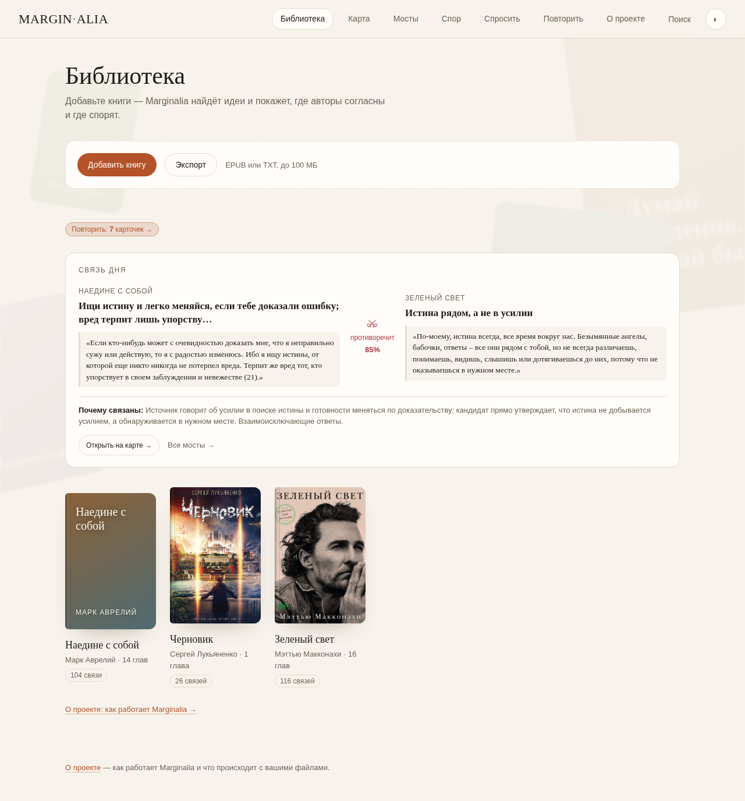
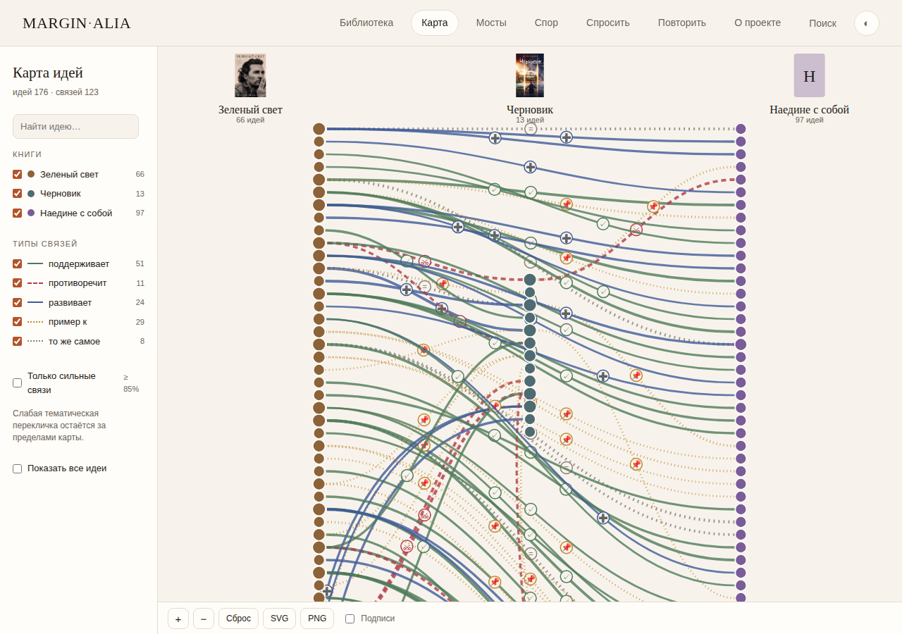
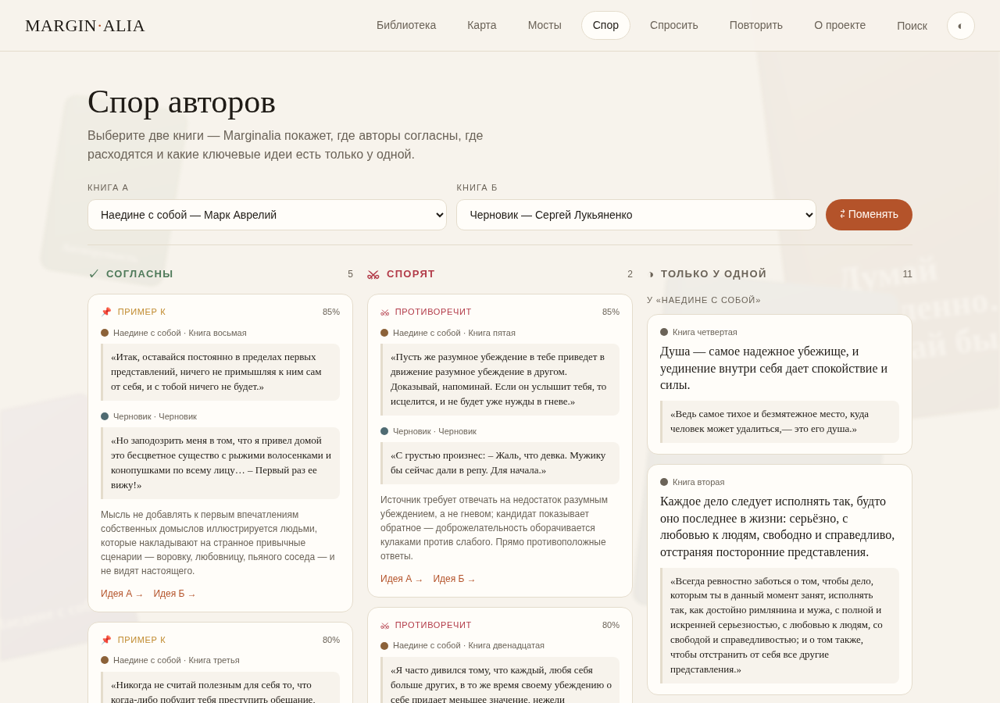
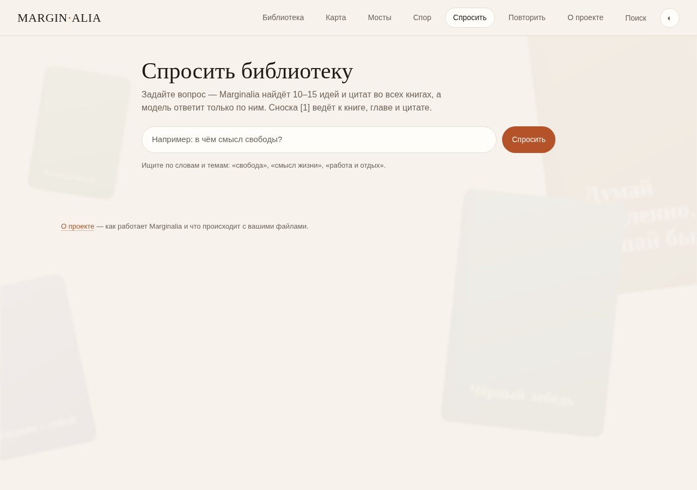

# Marginalia — карта идей из ваших книг

Marginalia разбирает книги на идеи, находит связи между ними и показывает, где авторы
согласны, где спорят и где говорят об одном и том же разными словами. Всё работает
локально: книги и заметки лежат в одном файле SQLite, никуда не отправляются, кроме
модели, которая выделяет идеи.



## Зачем это

Обычная читалка хранит страницы. Заметки хранят ваши мысли, но не видят связей между
книгами. Marginalia отвечает на вопрос «что эта книга говорит о том же, о чём я читал
в прошлой?»: каждая идея — это короткая мысль с **настоящей цитатой из текста**,
а не пересказ модели. Цитата сверяется с книгой посимвольно, и идея без цитаты
выбрасывается — поэтому на карте нет выдуманных мыслей.

## Попробовать за 2 минуты

Нужен Python 3.10+ (проверено на 3.12) и ничего больше — ни пакетов, ни сборки.

```bash
cd ~/work/projects/Knoweldge-graph-AI
python3 app/server.py 8000 --db demo/library-demo.db
```

Откройте <http://localhost:8000>. В демо-базе три книги, 381 идея и 123 связи;
текст глав обрезан до первых абзацев, чтобы база была лёгкой. Библиотека, карта,
мосты, поиск, повторение и спор работают без интернета. «Спросить» и пересчёт спора
зовут модель — им нужен класс-API моделей на `127.0.0.1:19040` (см. ниже).

## Экраны

| Библиотека: связь дня | Карта идей |
| --- | --- |
|  |  |
| Каждый день — одна пара идей из разных книг с объяснением связи. | Все идеи книги в колонках, связи — дугами; фильтры по книгам и типам связей. |

| Мосты между книгами | Спор авторов |
| --- | --- |
|  |  |
| Лучшие межкнижные связи с уверенностью и объяснением. | Две книги рядом: «согласны», «спорят» и идеи, которые есть только у одной. |

| Спросить библиотеку | Повторение |
| --- | --- |
|  |  |
| Вопрос по всем книгам: 10–15 идей и цитат, ответ со сносками [1], [2]. | 5–10 карточек в день из ключевых идей и связей, интервалы 1–3–7–21–60 дней. |


## Своя книга

1. Запустите сервер без `--db` — он откроет `data/library.db`:
   `python3 app/server.py 8000`
2. В браузере нажмите «Добавить книгу» и выберите EPUB или TXT (до 100 МБ).
3. Разберите книгу на идеи и связи — по одной команде на шаг:

   ```bash
   python3 app/extract.py <book_id> all   # идеи глав с настоящими цитатами
   python3 app/titles.py <book_id>        # короткие заголовки для карты
   python3 app/links.py all               # связи идей со всеми книгами
   python3 app/key_ideas.py <book_id>      # ключевые идеи книги
   python3 app/summary.py <book_id>        # конспект книги
   ```

   `<book_id>` виден в адресе книги: `#/book/<book_id>` (или в ответе `/api/books`).
4. Обновите страницу — на карте появятся новые связи.

Каждый скрипт можно запускать повторно: старые идеи, связи и конспект этой книги
заменяются новыми. `python3 app/extract.py <book_id> clean` удаляет идеи служебных
глав (титул, благодарности, об авторе, примечания).

## Как устроено

```
EPUB/TXT ──► server.py: разбор и сохранение ──► data/library.db
                                                (books, chapters)
        ┌───────────────────────────────────────────┘
        ▼
 extract.py   идеи главы + цитата, сверенная с текстом (≥ 90 % похожести)
 titles.py    заголовок идеи в 3–6 слов для карты
 links.py     кандидаты по общим словам → модель называет тип связи и уверенность
 key_ideas.py модель выбирает главные идеи книги (номерами, цитаты остаются)
 summary.py   конспект книги по ключевым идеям
        │
        ▼
 server.py: JSON API + раздача страницы ──► index.html (одна страница, без сборки)
```

- **Хранение** — SQLite (`sqlite3` из стандартной библиотеки), обложки — файлами
  в `data/covers/`.
- **Страница** — один `app/index.html`: HTML, CSS и JavaScript без сборки и без
  внешних библиотек. Маршруты — хеши (`#/map`, `#/bridges`, `#/ask`, …).
- **Связи** — пять типов: поддерживает, противоречит, развивает, пример к, то же
  самое. У каждой связи уверенность 0–1 и объяснение в 1–2 предложениях; на карте
  по умолчанию только связи ≥ 85 %.
- **Читатель проверяет связи**: «верно» / «неверно» на карточке связи. Отметки
  хранятся в `reviews` и влияют на карточки повторения.
- **Поиск** — стандартная библиотека: слова режутся на основы (первые пять букв),
  редкие слова весят больше (IDF). Результаты, где слово есть в заголовке или
  цитате, идут первыми.
- **Спросить библиотеку** — поиск отдаёт модели 10–15 фрагментов, модель отвечает
  только по ним; каждая сноска ведёт к книге, главе и цитате.

## Модели

Все обращения к модели идут через `app/llm.py` — единственное место с адресом
и именем модели:

- модель **DeepSeek-V4.1-Flash** через класс-API `http://127.0.0.1:19040/v1`
  (без ключа), `enable_thinking: false`;
- какая модель и когда: выделение идей, заголовки, типы связей, ключевые идеи,
  конспекты, ответ на вопрос, резюме спора;
- всё остальное — чистый Python: разбор EPUB, поиск кандидатов связей, ранжирование
  поиска, карта, карточки повторения.

Чтобы перейти на другую модель, достаточно поменять `API`, `MODEL` и разбор ответа
в `app/llm.py`.

## Ограничения

- Только EPUB и TXT, до 100 МБ; PDF пока не поддерживается.
- Качество идей и связей зависит от модели; цитаты проверяются, но тип связи —
  нет (его можно перепроверить: `python3 app/recheck_links.py`).
- Кандидаты связей ищутся по общим словам — связь без общих слов может не найтись.
- Основа слова — первые пять букв, это упрощение для русского и английского.
- Один пользователь, одна локальная база; аккаунтов и синхронизации нет.
- «Спросить» и «Пересчитать» в споре требуют доступа к класс-API модели; остальные
  экраны работают офлайн.
- В демо-базе текст глав обрезан до первых абзацев (идеи, цитаты и связи — полные).

## Планы

- PDF и DOCX, разбор оглавления и сносок.
- Эмбеддинги вместо общих слов для поиска кандидатов связей.
- Свои подборки книг и темы («свобода», «смысл жизни») поверх карты.
- Экспорт всей библиотеки в Markdown для Obsidian — уже есть: `python3 app/export_md.py`.
- Аккаунты и синхронизация между устройствами.

## Структура

```
app/
  server.py        HTTP-сервер, JSON API, разбор загрузки
  index.html       весь интерфейс: библиотека, карта, мосты, спор, спросить, повторение
  epub.py          разбор EPUB без сторонних библиотек
  llm.py           единственный клиент модели
  extract.py       идеи глав с проверкой цитат
  titles.py        короткие заголовки идей
  links.py         связи между идеями разных книг
  key_ideas.py     ключевые идеи книги
  summary.py       конспект книги
  ask.py           «Спросить библиотеку»
  debate.py        «Спор авторов»
  review.py        карточки повторения
  recheck_links.py строгая перепроверка типов связей
  export_md.py     экспорт в Markdown (Obsidian)
  export_demo.py   сборка демо-базы из рабочей
data/              рабочая база и обложки (не в git)
demo/              демо-база и обложки для быстрого старта
docs/              скриншоты для README
books/             исходные EPUB (не в git)
```

Сценарий демонстрации на 3–5 минут — в [DEMO.md](DEMO.md), история проекта
и планы — в [PLAN.md](PLAN.md).
